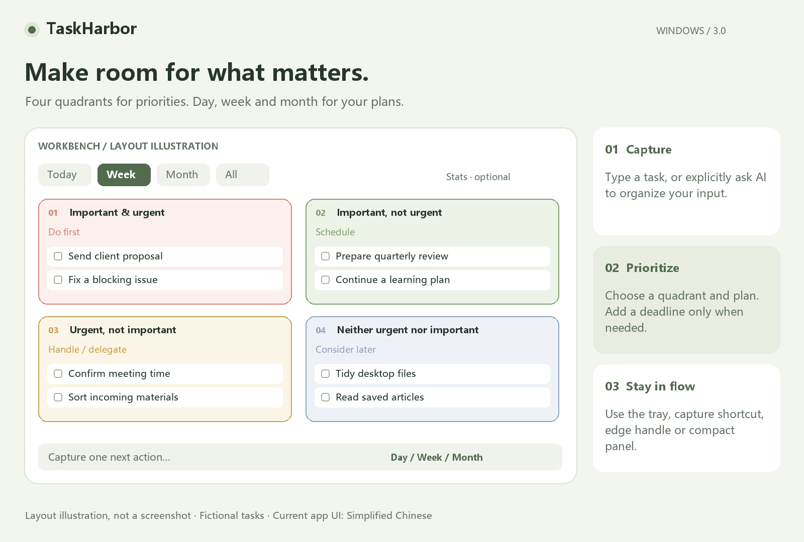
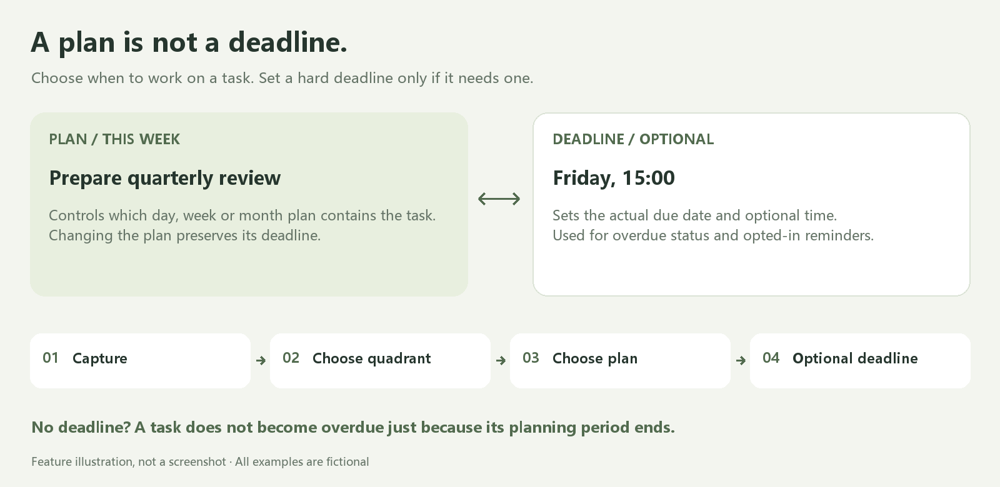

# TaskHarbor

**A calm, local-first task workspace for Windows.**

[](https://github.com/Crazyer-Flove/TaskHarbor/actions/workflows/ci.yml)
[](LICENSE)
[](#requirements)

[简体中文](README.zh-CN.md) · [Download](#download-and-run) · [User guide](docs/USER_GUIDE.md) · [Report a bug](https://github.com/Crazyer-Flove/TaskHarbor/issues/new/choose)

TaskHarbor brings an Eisenhower matrix, day/week/month planning and quick desktop capture into one personal workspace. Keep important work visible, collect small tasks without losing context, and give a task a deadline only when it actually has one.

**Current version: 3.0.3. The application interface is Simplified Chinese.** This English README documents the same application; an English interface is not currently implemented. Core task management works locally without an account or AI configuration.



*Documentation illustration with fictional tasks, not a screenshot. The English labels explain the layout; the current application UI is Simplified Chinese.*

## Contents

- [Features](#features)
- [Download and run](#download-and-run)
- [Your first task](#your-first-task)
- [Planning and deadlines](#planning-and-deadlines)
- [Desktop workflow and shortcuts](#desktop-workflow-and-shortcuts)
- [Reminders and recurring tasks](#reminders-and-recurring-tasks)
- [Optional AI assistance](#optional-ai-assistance)
- [Storage, backups and privacy](#storage-backups-and-privacy)
- [Build, test and package](#build-test-and-package)
- [Verification and current limits](#verification-and-current-limits)
- [Troubleshooting](#troubleshooting)
- [Contributing and license](#contributing-and-license)

## Features

Designed for individual work, study plans and everyday task capture on a Windows desktop.

| Area | Included behavior |
| --- | --- |
| Priorities | Four importance/urgency quadrants, drag-to-reclassify and an editor alternative to dragging |
| Planning | Day, week and month plans, a separate optional deadline, today/week/month/all filters |
| Views | Matrix and list views, search, expandable statistics and completion trends |
| Task details | A side editor, up to 50 subtasks per task, optional reminders and recurrence |
| Bulk actions | Complete selected tasks, schedule them for today or move them to the recycle bin |
| Recovery | Undo, recoverable deletion, import snapshots, failed-save rollback and retry |
| Desktop access | Workbench/compact layouts, tray entry, edge handle, pinning and a capture shortcut |
| AI assistance | Explicitly requested text/image extraction with an editable preview before adding tasks |
| Local ownership | JSON storage, task-only import/export and encrypted API keys for the current Windows user |

| Quadrant | Suggested action | Example |
| --- | --- | --- |
| Important and urgent | Do first | Finish a client proposal due soon |
| Important, not urgent | Schedule | Prepare a quarterly review or learning plan |
| Urgent, not important | Handle promptly; consider delegating outside the app | Confirm a meeting time |
| Neither important nor urgent | Review when time allows | Organize saved reading |

Quadrants are organizational labels. TaskHarbor does not assign work to other people or provide team collaboration.

## Download and run

### Requirements

| Component | Requirement |
| --- | --- |
| Operating system | Windows 10/11, **x64** |
| .NET | .NET Framework **4.6.2 or later** |
| Browser component | Installed Microsoft Edge **WebView2 Runtime** |
| Permissions | A writable user-data directory; normal use does not require administrator rights |
| Network | Not needed for core local tasks; needed for SDK restore or a remote AI service |

The embedded WebView2 **SDK** wrappers do not replace the installed **Runtime**. Current builds are unsigned.

### Download a Windows build

1. Open [GitHub Releases](https://github.com/Crazyer-Flove/TaskHarbor/releases).
2. Choose the version you want. The recommended download is `TaskHarbor-3.0.3-windows-x64.zip`, which includes the executable, documentation and license notices.
3. Extract the ZIP and run `TaskHarbor.exe`. Use the top-right edge handle, tray or registered capture shortcut to open the panel.
4. Alternatively, download the standalone [TaskHarbor.exe](https://github.com/Crazyer-Flove/TaskHarbor/releases/download/v3.0.3/TaskHarbor.exe) and keep the accompanying WebView2 license and third-party notices from the same Release.
5. Check file integrity against the Release's `SHA256SUMS.txt` if needed.

Release assets are public downloads. Source archives and a version manifest are also attached. [Windows CI artifacts](https://github.com/Crazyer-Flove/TaskHarbor/actions/workflows/ci.yml) remain available for development builds; the CI workflow itself does not publish Releases automatically.

Exit the previous DeskTodo application before the first normal launch so both applications do not write to a shared legacy task path.

## Your first task

1. Open the workbench from the edge handle or tray.
2. Type a short action in the bottom input, such as “Prepare quarterly review”.
3. Select **本日 / 本周 / 本月** (day/week/month) and the priority quadrant.
4. Expand **截止时间 · 可选** only if a deadline is needed, then press **Enter** or click Add.
5. Click the task title to open its side editor. Add subtasks, adjust its plan or enable a reminder, then save.
6. Complete the task when finished. Use undo for a mistaken action or the recycle bin to restore a deleted task.

The top filter and bottom new-task plan are separate controls. If a new task does not match the current filter, use the notice's “查看” action to view it instead of adding a duplicate.

## Planning and deadlines



*Feature illustration, not an application screenshot. Examples are fictional.*

**A plan answers “When will I work on this?” A deadline answers “When must it be finished?”** Changing a plan preserves its existing deadline. A task without a deadline does not become overdue just because its planning week or month ends.

| View | What it includes |
| --- | --- |
| Today | Day plans for today; overdue tasks are additionally included by default and can be excluded in settings |
| This week | Day and week plans overlapping the current week; month plans are not automatically included |
| This month | Day, week and month plans overlapping the current month |
| All | All tasks outside the recycle bin; completed tasks appear in the completed section |

Calendar calculations use local dates; weeks start on **Monday**. Statistics use the actual completion date in local time, rather than the planned date.

## Desktop workflow and shortcuts

- Switch between **工作台** (workbench) and **小面板** (compact panel) in the same window.
- Hover over the transparent edge-handle area to expand without clicking. Move away to collapse after the configured delay; moving across the handle-to-panel gap keeps it open. After manually collapsing while over the handle, leave and re-enter to reopen.
- Pin the panel to keep it open. Auto-collapse offers a 1, 3, 5 or 10 second delay, or manual-only mode.
- Both layouts dock to the top working-area edge. Hover to slide down (about 280 ms); leave to slide up (about 240 ms) after the configured delay. Returning during automatic closing reverses it smoothly. The idle handle sits near the top-right corner with a 24 logical-pixel right inset. Dragging can select another monitor; the handle returns to its top-right anchor.
- Entry, editing, confirmations and AI processing keep the panel expanded while work is in progress.
- The tray can open a layout, pause reminders for one hour or exit the application.

| Action | Shortcut |
| --- | --- |
| Global quick capture | `Ctrl+Shift+T`, when registration succeeds |
| Search tasks | `Ctrl+F` |
| Focus task entry | `Ctrl+N` |
| Save task edits | `Ctrl+Enter` |
| Undo the previous task operation | `Ctrl+Z`, outside an input field |
| Return, close an editor, cancel selection or collapse | `Esc`, depending on the active layer |

## Reminders and recurring tasks

### Reminders

Enable reminders in settings and opt in for each relevant task in its editor. A deadline date is required: a date with a time uses that time; a date without a time uses **09:00**.

- **TaskHarbor must remain running.** Exiting stops checks.
- The native host checks approximately every 10 seconds and catches up at most the preceding 24 hours.
- Default quiet hours are **22:00–08:00**; eligible reminders can be checked after quiet hours end.
- Snooze a task for 15 minutes or pause reminders for one hour from the tray.
- Notifications omit task titles; clicking opens the task. Windows notification policy or Do Not Disturb may suppress presentation.

No closed-application reminder scheduler or Windows scheduled task is installed.

### Recurrence

Daily, weekly and monthly recurrence is **completion-driven**. Completing a task creates its successor, which inherits its details, quadrant and reminder preference; subtask checkboxes reset.

Monthly recurrence preserves a month-day anchor: January 31 → the last day of February → March 31. Late completion produces one applicable current/future instance rather than a backlog of every missed occurrence.

Undoing completion also removes the newly generated occurrence. Simply reopening the old task is different: it does not delete an existing successor or create another duplicate when completed again.

## Optional AI assistance

Manual task management needs no AI configuration. To use **AI 整理**:

1. Open **设置 → AI 整理 · 可选配置**.
2. Select a compatible service; enter its base URL, model name and API key as appropriate.
3. Advanced settings support a custom endpoint path and a separate image model. The service must support the selected request type.
4. Enter text and optionally select up to **three images**.
5. Check the displayed destination, then explicitly request generation.
6. Review and edit proposed titles, quadrants, plans and deadlines before adding them.

Remote endpoints require an API key; local loopback endpoints may omit it. Image extraction requires image support from the selected model/service. There is no bundled hosted service or included quota; provider charges depend on your own service and account.

Only the text/images you explicitly submit go to the configured endpoint. TaskHarbor does not automatically send the task database to AI. Model output can be incorrect, so review the editable preview.

## Storage, backups and privacy

The default directory is `%APPDATA%\TaskHarbor`. Settings can select a custom task location; configuration and runtime state remain in the application-data directory.

| Data | Purpose |
| --- | --- |
| `tasks.json` | Content, plans, deadlines, completion, subtasks and recycle-bin state |
| `config.json` | Application preferences and encrypted AI keys |
| `reminder-state.json` | Reminder delivery/snooze bookkeeping |
| `WebView2/` | Embedded browser profile/cache |
| `backups/tasks-before-import-*.json` | Snapshot beside the task file before importing a backup |

Settings provide export, import, open data directory, change storage location and recycle bin actions. Task exports exclude configuration and API keys. The recycle bin does not empty itself; permanent clearing requires confirmation and cannot be undone.

Writes use atomic replacement. A failed save rolls back task state, retains the capture draft and offers retry. Invalid/corrupt task files block writes so an empty state does not overwrite the original.

API keys use Windows current-user **DPAPI** encryption. Task JSON and exports are **plaintext**, so protect backups as personal files. There is no built-in telemetry, account system or cloud sync.

### Upgrading from DeskTodo

The first normal launch copies old default data/configuration while retaining the original files. A legacy custom task path continues to be used. Existing deadlines are preserved; a `.before-taskharbor-v3.bak` snapshot is created before the first upgraded task-file write.

Try an isolated demo without automatic legacy migration:

```powershell
.\dist\TaskHarbor.exe --demo --data-dir .\build\demo
```

## Build, test and package

### Developer requirements

- Windows x64 and the .NET Framework compiler used by the build script.
- Windows PowerShell **5.1+**.
- **Git** to clone, or download/extract the source ZIP.
- **Node.js 22+** for JavaScript tests and the packaging source audit.
- Access to official NuGet for the first WebView2 SDK restore.

The app uses C# 5, Windows Forms, WebView2 and plain HTML/CSS/JavaScript. The supplied scripts need no npm installation, frontend bundler, backend server or Visual Studio project.

```powershell
git clone https://github.com/Crazyer-Flove/TaskHarbor.git
cd TaskHarbor

powershell -NoProfile -ExecutionPolicy Bypass -File scripts/restore.ps1
powershell -NoProfile -ExecutionPolicy Bypass -File scripts/test.ps1
powershell -NoProfile -ExecutionPolicy Bypass -File scripts/build.ps1
powershell -NoProfile -ExecutionPolicy Bypass -File scripts/package.ps1
```

For a build only, double-click `Build.cmd`. The first restore downloads pinned **Microsoft.Web.WebView2 1.0.4191.47** from official NuGet. Pass `-NoRestore` to `build.ps1` when dependencies are already restored.

| Output in `dist/` | Contents |
| --- | --- |
| `TaskHarbor.exe` | Windows x64 app with embedded UI and SDK wrappers |
| `release.json` | Version, platform, size, SDK version and executable SHA-256 |
| `TaskHarbor-3.0.3-windows-x64.zip` | Executable, manifest, documentation and notices |
| `TaskHarbor-3.0.3-source.zip` | Allowlisted source, documentation, assets and GitHub templates |
| `SHA256SUMS.txt` | Checksums for the executable and both ZIPs |

The source archive excludes personal data, configuration, restored dependencies and runtime profiles. The source ZIP is generated locally; current CI uploads the Windows ZIP and checksums.

### Binary diagnostics

After building, run a noninteractive check of the actual executable using an isolated directory:

```powershell
$p = Start-Process .\dist\TaskHarbor.exe -ArgumentList '--self-test --data-dir .\build\binary-check' -PassThru -Wait
Get-Content .\build\binary-check\self-test.json
Get-FileHash .\dist\TaskHarbor.exe -Algorithm SHA256
```

This checks embedded resources, the native loader, installed Runtime and directory writes. It does not exercise the rendered UI or real notification presentation.

### Repository layout

```text
TaskHarbor/
├── src/             C# host, storage, AI transport and native services
├── web/             Local UI, controller and independent task model
├── assets/          Application icon
├── tests/           Domain, controller and native checks
├── scripts/         Restore, build, test, packaging and source audit
├── docs/
│   ├── images/      Bilingual README illustrations
│   └── *.md         Guides, architecture and verification records
├── examples/        Fictional sample tasks
├── .github/         Windows CI and issue/pull-request templates
├── Build.cmd        Build entry point
├── README.zh-CN.md  Chinese documentation
└── LICENSE          MIT License
```

`build/` and `dist/` are generated locally and ignored by Git.

## Verification and current limits

| Verification | Recorded result |
| --- | --- |
| Domain/static checks | 39 passed |
| UI-controller checks in a DOM test double | 13 passed |
| Native C# checks with isolated fixtures | 53 passed |
| Clean source restore/build and binary diagnostics | Passed in the recorded local environment |
| Hosted Windows CI | [Initial source publication passed](https://github.com/Crazyer-Flove/TaskHarbor/actions/runs/40647826123); the badge shows the latest run |
| Desktop visual, DPI, accessibility and multi-monitor acceptance | Still requires manual verification |

The **105 automated checks** cover rules, failure recovery, recurrence, storage, migration and reminder timing. They do not establish that every desktop interaction or visual state has passed. See [the verification record](docs/VERIFICATION.md) and [design QA](design-qa.md).

Current scope is a personal Windows application. There is no macOS/Linux build, English UI, account/cloud sync, team assignment, automatic updater or closed-app reminder scheduler. Real provider requests and final desktop behavior need environment-specific testing.

## Troubleshooting

| Symptom | What to check |
| --- | --- |
| No panel after launching | Look for the edge handle or tray; try `Ctrl+Shift+T` if registered |
| WebView2 initialization fails | Installed Runtime, Windows/.NET compatibility and a writable data directory |
| Global shortcut does not work | Another app may own it; use the tray or edge handle |
| A new task seems missing | Scope/search and the task's plan; switch to All or use the notice's “查看” action |
| Changes fail to save | Storage path and write permissions; retry after correcting the cause |
| Task data cannot be loaded | Preserve the original and restore a known backup; do not overwrite it with an empty export |
| Reminders do not appear | Running app, task date, opt-in, quiet hours, snooze and Windows notification settings |
| AI errors or incorrect proposals | URL, endpoint path, model capability and key; inspect the preview |
| SDK restore cannot connect | Access to official NuGet, then rerun `scripts/restore.ps1` |
| Actions download unavailable | Sign in, choose a successful run or build from source if artifacts expired |

More information: [User guide](docs/USER_GUIDE.md) · [Development](docs/DEVELOPMENT.md) · [Publishing](docs/PUBLISHING.md) · [Security](SECURITY.md).

## Contributing and license

Open [a bug report or feature request](https://github.com/Crazyer-Flove/TaskHarbor/issues/new/choose), or fork and submit a pull request. Read [CONTRIBUTING.md](CONTRIBUTING.md) before changing task schemas, window behavior or persistence. Include Windows/app versions and reproduction steps; use fictional/redacted tasks in screenshots.

Source and first-party assets use the [MIT License](LICENSE). Microsoft WebView2 components retain their own terms; see [THIRD_PARTY_NOTICES.md](THIRD_PARTY_NOTICES.md). The product name does not imply trademark registration or exclusive naming rights.
