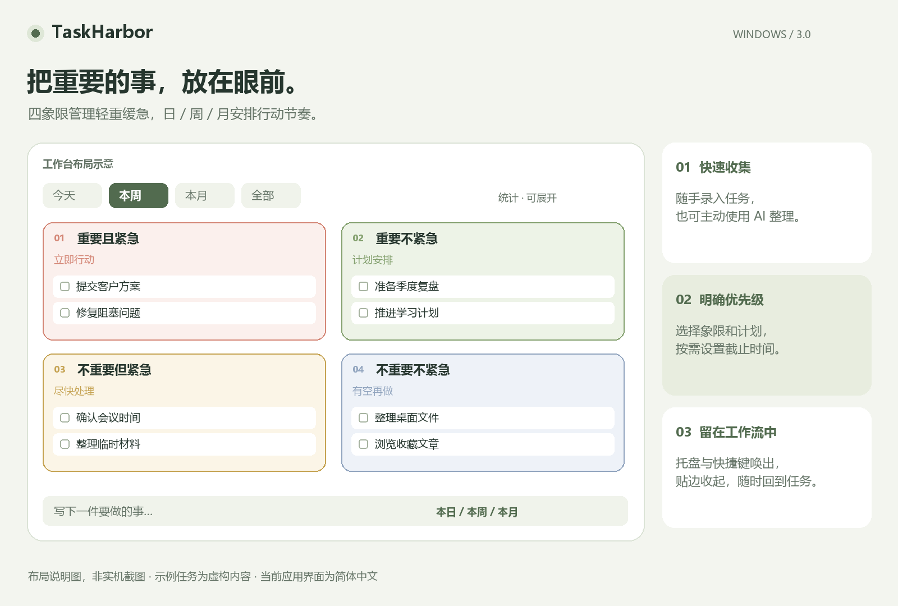
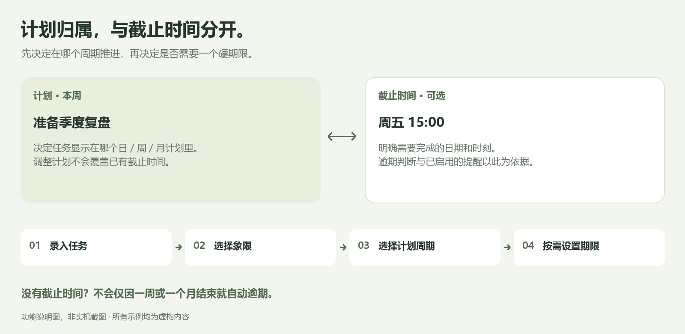

# TaskHarbor

**让待办有处安放，让重要的事持续向前。**

[](https://github.com/Crazyer-Flove/TaskHarbor/actions/workflows/ci.yml)
[](LICENSE)
[](#运行要求)

[English](README.md) · [下载与运行](#下载与运行) · [使用说明](docs/USER_GUIDE.md) · [反馈问题](https://github.com/Crazyer-Flove/TaskHarbor/issues/new/choose)

TaskHarbor 是一款面向个人的 Windows 桌面任务工具，将四象限、日／周／月计划和桌面快速录入放进同一个工作空间。把重要的事留在眼前，随手记录临时任务，只为确实有期限的任务设置截止时间。

**当前版本：3.0.3；应用操作界面为简体中文。** 英文 README 是同一款应用的英文说明，不代表已经提供英文操作界面。基础任务管理无需注册账号，也无需配置 AI。



*配图为文档布局示意，使用虚构任务，并非应用实机截图。最终桌面视觉与交互的验收状态见文末验证说明。*

## 目录

- [可以做什么](#可以做什么)
- [下载与运行](#下载与运行)
- [创建第一条任务](#创建第一条任务)
- [计划周期与截止时间](#计划周期与截止时间)
- [桌面使用与快捷键](#桌面使用与快捷键)
- [提醒与重复任务](#提醒与重复任务)
- [可选的 AI 整理](#可选的-ai-整理)
- [存储、备份与隐私](#存储备份与隐私)
- [源码构建、测试与打包](#源码构建测试与打包)
- [验证状态与当前边界](#验证状态与当前边界)
- [常见问题](#常见问题)
- [参与贡献与开源许可](#参与贡献与开源许可)

## 可以做什么

适用于个人工作安排、学习计划，以及 Windows 桌面上的日常任务收集。

| 方向 | 已实现的功能 |
| --- | --- |
| 优先级 | 四个重要／紧急象限；支持拖动归类，也可在编辑器中修改 |
| 计划安排 | 本日、本周、本月计划；独立的可选截止时间；今天／本周／本月／全部筛选 |
| 查看方式 | 四象限看板、列表、搜索、可展开统计与完成趋势 |
| 任务详情 | 侧边编辑、每项最多 50 个子任务、可选提醒和重复规则 |
| 批量处理 | 批量完成、安排今天、移入回收站 |
| 操作恢复 | 撤销、回收站、导入前备份、保存失败回滚与重试 |
| 桌面入口 | 工作台／小面板、系统托盘、贴边把手、固定、全局录入快捷键 |
| AI 辅助 | 主动发起文字／图片整理，预览修改后再加入 |
| 本地数据 | JSON 存储、任务导入导出、当前 Windows 用户加密 API Key |

| 象限 | 处理思路 | 示例 |
| --- | --- | --- |
| 重要且紧急 | 优先解决，立即行动 | 完成即将到期的客户方案 |
| 重要不紧急 | 计划安排，持续推进 | 季度复盘、长期学习计划 |
| 不重要但紧急 | 尽快处理，必要时在应用外委派 | 确认会议时间 |
| 不重要不紧急 | 有空再做，定期取舍 | 整理收藏文章 |

象限用于个人组织任务；应用没有多人协作或将任务分配给其他人的功能。

## 下载与运行

### 运行要求

| 项目 | 要求 |
| --- | --- |
| 操作系统 | Windows 10／11，**x64** |
| .NET | .NET Framework **4.6.2 或更高版本** |
| 浏览器组件 | 已安装 Microsoft Edge **WebView2 Runtime** |
| 权限 | 用户数据目录可写；正常使用无需管理员权限 |
| 网络 | 基础任务管理可离线；首次恢复 SDK 或调用远程 AI 服务需要网络 |

EXE 内嵌的 WebView2 **SDK** 组件不能代替系统中的 **Runtime**。当前构建未附带代码签名。

### 下载 Windows 构建产物

1. 打开 [GitHub Releases 下载页](https://github.com/Crazyer-Flove/TaskHarbor/releases)。
2. 选择版本，推荐下载 `TaskHarbor-3.0.3-windows-x64.zip`，包含 EXE、文档和许可说明。
3. 解压后运行 `TaskHarbor.exe`，通过屏幕右上方把手、托盘或快捷键打开工作区。
4. 也可直接下载 [TaskHarbor.exe](https://github.com/Crazyer-Flove/TaskHarbor/releases/download/v3.0.3/TaskHarbor.exe)，并保留同一 Release 提供的 WebView2 许可与第三方说明。
5. 如需校验文件完整性，可对照 Release 中的 `SHA256SUMS.txt`。

Release 附件提供公开下载，并附带源码压缩包和版本清单。[Windows CI 产物](https://github.com/Crazyer-Flove/TaskHarbor/actions/workflows/ci.yml)继续用于开发构建；CI 工作流自身不自动发布 Release。

从旧版 DeskTodo 升级时，首次正常启动前先退出旧版，避免同时修改旧版自定义路径中的任务文件。

## 创建第一条任务

1. 通过屏幕边缘把手或托盘打开工作台。
2. 在底部输入明确的行动，例如“准备季度复盘”。
3. 选择 **本日／本周／本月** 和归属象限。
4. 确实有期限时再展开 **截止时间 · 可选**，然后按 **Enter** 或点击添加。
5. 点击任务标题打开侧边编辑，添加子任务、调整计划或启用提醒，完成后保存。
6. 完成后勾选任务。误操作可以撤销；删除项可从回收站恢复。

顶部查看范围与底部新建计划是独立设置。新任务不符合当前筛选时，可点击保存提示中的“查看”，不要因为当前看板没有出现它而重复添加。

## 计划周期与截止时间



*功能说明图，并非应用截图；示例均为虚构内容。*

**计划回答“打算什么时候推进”，截止时间回答“最晚什么时候完成”。** 修改计划不会覆盖已有截止时间。没有截止时间的任务，不会仅因一周或一个月结束就自动逾期。

| 查看范围 | 包含的任务 |
| --- | --- |
| 今天 | 今天的日计划；默认额外包含逾期任务，可在设置中关闭 |
| 本周 | 与本周重叠的日、周计划；不会自动纳入整月计划 |
| 本月 | 与本月重叠的日、周、月计划 |
| 全部 | 所有未移入回收站的任务；已完成项在完成区域展示 |

周期按本地日历计算，**一周从周一开始**。完成统计按实际完成时刻对应的本地日期计算，不按原计划日期计算。

## 桌面使用与快捷键

- 在同一窗口中切换“工作台”和“小面板”。
- 鼠标移入透明把手区域即展开，无需点击；移出后按配置延迟收起。从把手移向面板时保持展开。若手动收起时鼠标还在把手内，先移出再移入才会再次展开。
- 点击“固定”保持展开；自动收起可设为 1、3、5、10 秒，或仅手动。
- 收起与展开均贴在当前屏幕工作区上方，约 280 毫秒下滑展开、240 毫秒上滑收起；鼠标在自动收起时返回会从当前位置重新展开。静默把手固定在顶部靠右，距右边缘约 24 个逻辑像素；拖动可选择其他显示器，松手后回到该屏幕右上方。
- 录入、编辑、确认和 AI 处理期间，面板保持展开。
- 托盘提供打开面板、暂停提醒 1 小时和退出入口。

| 操作 | 快捷键 |
| --- | --- |
| 全局唤出录入 | `Ctrl+Shift+T`，注册成功时生效 |
| 搜索任务 | `Ctrl+F` |
| 聚焦录入框 | `Ctrl+N` |
| 保存任务编辑 | `Ctrl+Enter` |
| 撤销上一次任务操作 | `Ctrl+Z`，焦点不在输入框时 |
| 返回、关闭编辑、取消批量或收起 | `Esc`，按当前所在层处理 |

## 提醒与重复任务

### 提醒规则

在设置中允许提醒，并在需要提醒的任务编辑页单独勾选。任务需填写截止日期：有日期和时刻则按该时刻提醒；只有日期则默认当天 **09:00** 提醒。

- **程序必须保持运行**；退出后停止检查。
- 原生宿主约每 10 秒检查一次，最多补查过去 24 小时。
- 默认 **22:00–08:00** 静默，结束后补查范围内的待提醒项。
- 单项可延后 15 分钟；托盘可暂停全部提醒 1 小时。
- 系统通知不展示任务标题，点击打开任务；Windows 免打扰或通知策略可能影响显示。

当前版本不安装 Windows 计划任务，也不提供关闭应用后的提醒调度。

### 重复任务

支持“**完成后生成下一日／周／月**”。下一次继承任务内容、象限、子任务与提醒偏好，子任务勾选状态重置。

月度重复保留原始日期锚点，例如：1 月 31 日 → 2 月最后一天 → 3 月 31 日。晚完成只生成一个适用的当前／后续周期实例，不一次性补出所有错过的任务。

撤销完成时会连同刚生成的下一次一起撤销。单独改回未完成则不同：它不会删除已有后续任务，再次完成时也不会额外生成重复实例。

## 可选的 AI 整理

手动管理任务不依赖 AI。需要时可以这样配置：

1. 打开 **设置 → AI 整理 · 可选配置**。
2. 选择兼容服务，填写接口地址、模型名称和 API Key。
3. 高级设置支持自定义接口路径、独立图片模型；服务需支持对应请求形式。
4. 打开“AI 整理”，输入文字，或选择最多 **3 张图片**。
5. 确认界面展示的发送目标，再主动生成。
6. 检查并修改标题、象限、计划和截止时间，确认后加入。

远程接口需要 API Key；本地回环接口可以不填。图片整理需要模型／服务支持图片输入。项目不附带托管服务或免费额度；具体费用取决于使用的服务与账号。

只有主动提交的文字和所选图片会发送到配置的服务，应用不会自动上传整个任务库。模型结果可能不准确，因此加入前提供可编辑预览。

## 存储、备份与隐私

默认目录为 `%APPDATA%\TaskHarbor`。设置可更换任务位置，配置和运行状态仍在应用数据目录。

| 数据 | 用途 |
| --- | --- |
| `tasks.json` | 正文、计划、期限、完成情况、子任务和回收站状态 |
| `config.json` | 应用偏好与加密后的 AI Key |
| `reminder-state.json` | 已提醒、延后提醒等状态 |
| `WebView2/` | 内嵌浏览器用户配置与缓存 |
| `backups/tasks-before-import-*.json` | 导入前快照，位于任务文件旁的备份目录 |

设置提供“导出任务备份”“导入备份”“打开数据目录”“更换存储位置”“回收站”。任务导出不包含配置或 API Key。回收站不会自动清空；永久清空需要明确确认，且不能撤销。

写入使用原子替换。保存失败时还原任务状态、保留草稿，并提供重试。文件无效或损坏时会阻止写入，避免用空数据覆盖原文件。

API Key 通过 Windows 当前用户 **DPAPI** 加密；任务 JSON 与导出备份是**明文**，应按个人文件妥善保管。应用没有内置遥测、账号系统或云同步。

### 从 DeskTodo 升级

首次正常启动复制旧版默认数据与配置并保留原文件；旧自定义任务路径继续沿用。原有截止日期不会清空，第一次写入升级后的任务文件前生成 `.before-taskharbor-v3.bak` 快照。

使用独立数据目录体验演示：

```powershell
.\dist\TaskHarbor.exe --demo --data-dir .\build\demo
```

指定 `--data-dir` 会禁用自动旧版迁移，不读取默认个人数据目录。

## 源码构建、测试与打包

### 开发环境

- Windows x64，以及构建脚本使用的 .NET Framework 编译器。
- Windows PowerShell **5.1+**。
- **Git**；也可以下载并解压源码 ZIP。
- **Node.js 22+**，用于 JavaScript 测试和打包时的源码检查。
- 首次恢复 WebView2 SDK 时能访问官方 NuGet。

采用 C# 5、Windows Forms、WebView2 和原生 HTML／CSS／JavaScript。提供的脚本无需 npm 依赖、前端打包器、后端服务或 Visual Studio 项目。

```powershell
git clone https://github.com/Crazyer-Flove/TaskHarbor.git
cd TaskHarbor

powershell -NoProfile -ExecutionPolicy Bypass -File scripts/restore.ps1
powershell -NoProfile -ExecutionPolicy Bypass -File scripts/test.ps1
powershell -NoProfile -ExecutionPolicy Bypass -File scripts/build.ps1
powershell -NoProfile -ExecutionPolicy Bypass -File scripts/package.ps1
```

仅构建可双击 `Build.cmd`。首次从官方 NuGet 恢复固定版本 **Microsoft.Web.WebView2 1.0.4191.47**；依赖已恢复时，可向 `build.ps1` 传入 `-NoRestore`。

| `dist/` 中的文件 | 内容 |
| --- | --- |
| `TaskHarbor.exe` | 内嵌 UI 与 SDK 组件的 Windows x64 程序 |
| `release.json` | 版本、平台、体积、SDK 版本和 EXE 的 SHA-256 |
| `TaskHarbor-3.0.3-windows-x64.zip` | EXE、清单、文档与许可 |
| `TaskHarbor-3.0.3-source.zip` | 白名单内的源码、文档、资源和 GitHub 模板 |
| `SHA256SUMS.txt` | EXE 与两个 ZIP 的校验值 |

源码包排除个人任务、配置、已恢复的依赖和运行缓存。源码 ZIP 可在本地生成；当前 CI Artifact 上传 Windows ZIP 与校验值。

### 二进制诊断

构建后，通过独立目录对实际 EXE 执行非交互自检：

```powershell
$p = Start-Process .\dist\TaskHarbor.exe -ArgumentList '--self-test --data-dir .\build\binary-check' -PassThru -Wait
Get-Content .\build\binary-check\self-test.json
Get-FileHash .\dist\TaskHarbor.exe -Algorithm SHA256
```

自检覆盖内嵌资源、原生加载器、已安装 Runtime 和目录写入；不覆盖真实桌面渲染、操作流程或系统通知展示。

### 目录结构

```text
TaskHarbor/
├── src/             C# 宿主、存储、AI 请求与原生桌面服务
├── web/             本地 UI、控制器和独立任务模型
├── assets/          应用图标
├── tests/           任务规则、UI 控制器和原生检查
├── scripts/         依赖恢复、构建、测试、打包与源码检查
├── docs/
│   ├── images/      中英文 README 配图
│   └── *.md         使用、架构和验证文档
├── examples/        虚构任务示例
├── .github/         Windows CI、Issue 与 PR 模板
├── Build.cmd        构建入口
├── README.md        英文说明
└── LICENSE          MIT 许可证
```

`build/` 和 `dist/` 为本地生成目录，不提交到 Git。

## 验证状态与当前边界

| 项目 | 已记录的结果 |
| --- | --- |
| 任务模型／静态检查 | 39 项通过 |
| 基于模拟 DOM 的 UI 控制器检查 | 13 项通过 |
| 独立测试数据的 C# 原生检查 | 53 项通过 |
| 干净源码恢复依赖、构建与实际 EXE 诊断 | 在已记录的本地环境通过 |
| GitHub Windows CI | [首次源码发布已通过](https://github.com/Crazyer-Flove/TaskHarbor/actions/runs/40647826123)；最新状态见页首徽章 |
| 桌面视觉、DPI、无障碍与多屏验收 | 仍需人工验证 |

共 **105 项自动化检查**，覆盖任务规则、失败恢复、重复任务、存储、迁移与提醒时机。自动化通过不代表每种桌面交互和视觉状态都已验收。完整记录见 [VERIFICATION.md](docs/VERIFICATION.md) 和 [design-qa.md](design-qa.md)。

当前为个人 Windows 应用，尚无 macOS／Linux 版本、英文界面、账号／云同步、团队分派、自动更新器或关闭应用后的提醒调度。真实 AI 服务和最终桌面交互仍需在实际环境验证。

## 常见问题

| 问题 | 排查方式 |
| --- | --- |
| 启动后没看到面板 | 查看边缘把手或托盘；快捷键注册成功时可按 `Ctrl+Shift+T` |
| WebView2 初始化失败 | 检查 Runtime、Windows／.NET 环境和目录写入权限 |
| 全局快捷键无效 | 可能被其他程序占用，可通过托盘或把手打开 |
| 新任务添加后没出现 | 检查周期、搜索和任务计划；切换“全部”或点击“查看” |
| 修改无法保存 | 检查存储路径和写入权限，修正后重试 |
| 无法加载任务文件 | 保留原文件，再从已知备份恢复，不用空导出覆盖 |
| 没收到提醒 | 检查程序运行、日期、提醒开关、静默／暂停／延后和系统通知设置 |
| AI 报错或结果不符预期 | 核对地址、路径、模型能力和 Key，加入前检查预览 |
| SDK 恢复连接失败 | 检查官方 NuGet 网络可达性，再执行 `scripts/restore.ps1` |
| 无法下载 Actions 产物 | 登录 GitHub 并选择成功运行；产物过期则从源码构建 |

更多说明：[使用指南](docs/USER_GUIDE.md) · [开发文档](docs/DEVELOPMENT.md) · [发布指南](docs/PUBLISHING.md) · [安全与隐私](SECURITY.md)。

## 参与贡献与开源许可

欢迎提交 [Bug 或功能建议](https://github.com/Crazyer-Flove/TaskHarbor/issues/new/choose)，或 Fork 后发起 Pull Request。修改任务结构、窗口行为或持久化前，请阅读 [CONTRIBUTING.md](CONTRIBUTING.md)。反馈附上 Windows／应用版本和复现步骤；截图使用虚构任务或先脱敏。

源码与自有资源采用 [MIT License](LICENSE)。Microsoft WebView2 组件遵循自身许可，见 [THIRD_PARTY_NOTICES.md](THIRD_PARTY_NOTICES.md)。产品名称不代表已注册商标或享有名称排他权。
